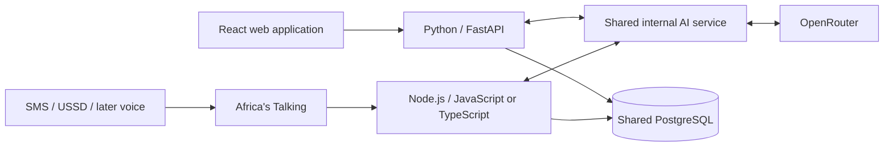
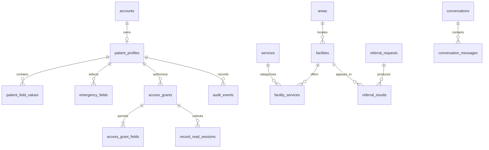

# HealthAccess — Plan 1: Online application, FastAPI, shared data and AI contracts

Version: 1.0 · 16 November 2026

Source: the supplied `HealthAccess_Project_Brief.md`, with the user's subsequent architecture diagram and corrections taking precedence. This is an implementation specification, not a claim that production services have been built. Supporting libraries remain the development team's choice.

## 1. The architecture to implement

**FastAPI serves online access. Node.js serves offline access through Africa's Talking. Neither backend calls the other to complete patient requests. Both use PostgreSQL and a separately addressable AI service.**



| Component | Owns | Must not own |
|---|---|---|
| React | Screens, conversation display, approved generative UI components, form validation and user confirmation | Authorization decisions, model/provider credentials, direct database access |
| FastAPI | Web authentication, patient profile changes, web chat, online record access, web recommendations and administration | Telecom callback handling |
| Node.js | Africa's Talking callbacks, SMS assistant, USSD state machine, telecom jobs and later voice adapter | Web screen APIs; dependence on FastAPI for protected record access or AI |
| Shared AI service | Intent interpretation, reviewed-content retrieval, general health answers, structured suggestions | Granting access, executing writes, inventing facilities or sending arbitrary UI code |
| PostgreSQL | Central records, facilities, sessions, grants, permissions, audit trail and durable queues | Separate competing schemas maintained by each backend |

The AI service is a separate internal deployment or independently addressable service. Its implementation language can be Python or Node.js. It is **not an endpoint hosted inside the web FastAPI deployment that Node.js must depend on**.

Referral means recommending and directing someone to a suitable nearby facility. No transfer approval, bed reservation, booking or hospital-to-hospital workflow is implied. Selecting a hospital does not send it a medical record.

### Scope for the first release

- Patient portal, practitioner lookup and directory administration.
- Conversational online assistance and structured UI responses, added by the latest user request.
- Structured patient-controlled health fields, emergency summaries and temporary read grants.
- Suitable nearby hospital recommendations, with a list view that works without a map provider.
- SMS and USSD via the independent Node.js service; see Plan 2.
- Real-time voice stays a later release, subject to telecom audio capability checks.

Full clinical document ingestion, prescribing, appointment booking and hospital EHR integration are separate projects. Do not silently imply these features in the first UI.

## 2. First implement three complete user journeys

### A. Ask for care

1. User opens the assistant, with or without signing in.
2. User describes their request, e.g. “Find child care near Ikeja.”
3. FastAPI verifies the conversation belongs to this account or anonymous session.
4. AI returns a validated intent and candidate service/location, not a hospital recommendation invented by the model.
5. If service or area is unclear, show a short question with choices.
6. If the signed-in patient explicitly allows profile use, FastAPI reads only the permitted fields. The default is off.
7. FastAPI queries the facility directory: filter by relevant service, then rank suitable results by proximity.
8. React renders facility cards with name, address, service match, approximate distance and contact when present.
9. Selecting a card reveals details and usable contact/direction actions, only where directory data supports them.

### B. Manage emergency information

1. Patient signs in and edits their health profile.
2. Patient selects exactly which emergency fields may be shared.
3. Show a preview of the resulting public-by-code summary before saving.
4. Anyone with the patient's permanent patient code can request that selected summary.
5. The server returns only selected fields and records an access event.

### C. Grant additional read access

1. Patient chooses additional fields, permitted channels and expiry.
2. UI makes clear that a recipient also needs the patient code.
3. Patient explicitly presses **Create access code**.
4. Backend creates a temporary grant and returns the code on issuance.
5. A signed-in, approved practitioner uses both codes in the web portal. A USSD user can use both codes through the scoped bearer-access flow described in Plan 2.
6. Every subsequent read rechecks the grant, channel, actor/session binding and expiry.
7. Revocation blocks subsequent reads. It cannot remove information already viewed, copied or delivered by SMS.

## 3. Roles and authorization matrix

| Actor | Emergency lookup with patient code | Additional record fields | Edit patient fields | Manage facilities |
|---|---|---|---|---|
| Guest | Only the patient-selected emergency fields | No web access | No | No |
| Patient | Same public lookup, plus full access to their own profile | Own fields; can create/revoke grants | Own fields | No |
| Approved practitioner | Yes | Valid patient code + temporary code, within permitted scope | No, in this release | No |
| Directory administrator | Same public lookup as everyone else | No automatic clinical access | No automatic patient access | Yes |
| USSD bearer of both codes | Yes | Only fields authorized for USSD, while grant is valid | No | No |

Roles are server-assigned. Registration must not accept `role=admin` or self-approve a practitioner. A patient code is an identifier with limited bearer access, not a login credential. Possessing a phone number is not proof of ownership of a patient record.

### Shared permission enforcement across two languages

Keep the critical record-access policy in versioned PostgreSQL routines, called independently by FastAPI and Node.js:

| Routine contract | Responsibility |
|---|---|
| `read_emergency_summary(code_digest, actor_context)` | Resolve active code, select permitted fields, append audit event |
| `open_granted_record(patient_code_digest, grant_code_digest, actor_context)` | Check matching patient, expiry, revocation, channel and actor eligibility; establish a short-lived read session |
| `read_granted_record(read_session_id, actor_context)` | Recheck current grant and return the permitted projection on every read |
| `save_emergency_fields(patient_id, actor_id, keys, expected_version)` | Verify ownership and update selections atomically |
| `create_read_grant(patient_id, actor_id, field_keys, channels, expiry, code_digest)` | Verify ownership, validate scope and create grant plus its field rows atomically |
| `revoke_read_grant(grant_id, actor_id)` | Verify ownership; revoke grant and dependent read sessions atomically |
| `find_suitable_facilities(service_code, location, radius, limit)` | Shared deterministic service filtering and geographic ranking |

These are logical function signatures to implement, not existing database functions. Hash incoming codes in the backend using a shared protected digest key. Separate web and telecom wrappers must derive their channel from their database identity, rather than trust a public `channel` parameter. The caller must authenticate the account or establish the allowed USSD bearer context before invoking the routine. Actor IDs sent by the browser are never trusted.

Use restricted database roles. Neither application should have database-owner privileges. The Node role may read approved facility data and execute authorized record routines but cannot select unrestricted patient tables. If using `SECURITY DEFINER`, use a non-login owner, fixed safe `search_path`, fully qualified object names and explicit `EXECUTE` grants; revoke public execution. Audit successful reads in the same transaction. Rate limiting and audit of rejected attempts must remain effective even when a transaction rolls back.

Publish JSON Schema contracts plus shared test vectors to both teams. Include expired, revoked, wrong-patient, wrong-channel, unknown-field and ownership-denial cases. One migration pipeline owns the shared schema.

## 4. React screens and routes

| Frontend route | Access | Screen and main actions |
|---|---|---|
| `/` | Public | Assistant, suggested questions, location clarification and generated care cards |
| `/login`, `/register` | Public | Sign in or create a patient account |
| `/app` | Patient | Continue chat, profile completeness, own patient code |
| `/app/profile` | Patient | Edit structured health fields and preferred language |
| `/app/emergency-summary` | Patient | Select fields, preview exact public summary, save |
| `/app/access` | Patient | Create temporary access, see active grants, revoke |
| `/app/access-log` | Patient | Who/channel, time, permitted field names and outcome |
| `/app/channel-settings` | Patient | Verified phone linkage and optional SMS/USSD profile-use consent |
| `/lookup` | Public | Enter patient code; display only emergency projection |
| `/practitioner/lookup` | Approved practitioner | Enter patient code and temporary code |
| `/practitioner/records/:readSessionId` | Bound practitioner | Read-only permitted fields and expiry |
| `/find-care` | Public | Structured alternative to chat: service + area/location |
| `/find-care/results` | Public/session owner | Suitable facilities, distance basis, no-match or clarification state |
| `/facilities/:facilityId` | Public | Directory details and source freshness |
| `/admin/facilities` | Directory administrator | Search/create/update/deactivate listings and service availability |
| `/admin/practitioners` | Authorized account administrator | Review practitioner status; no automatic record access |

Recommended component boundaries:

```text
src/
  app/                 routes, app shell, session guards
  features/chat/       transcript, composer, conversation state
  features/care/       request form, facility cards and details
  features/records/    profile editor, public summary, read-only viewer
  features/sharing/    field picker, expiry picker, grant list
  features/admin/      facility and practitioner administration
  generative-ui/       schema validation, component registry, action dispatcher
  api/                 typed API adapter, errors, retry and idempotency handling
  components/          accessible forms, buttons, dialogs and status displays
```

Every screen needs loading, empty, validation, denied and retry states. A denied location permission must fall back to area/landmark input. A failed save must retain the user's draft and must not show “saved”. Patient data and access codes must not appear in URL paths, query strings, analytics or error reporting. Use `Cache-Control: no-store` on sensitive API responses; avoid a service worker cache of medical content in the first release.

## 5. Generative UI: structured data, approved components

The AI helps select a useful interaction. The backend validates and builds the final component payload. React renders it through an allowlist. **Never render model-produced HTML, JavaScript, arbitrary URLs or API routes.**

| Component type | Example trigger | What it displays | Allowed action |
|---|---|---|---|
| `clarification` | “Find a hospital” with no location | One question and area/service choices | Submit selected answer |
| `facility_list` | Service and location resolved | Directory-backed hospital cards | Open one listed facility |
| `facility_detail` | User selects a result | Address, services, contact, distance basis | Open validated directions/contact link |
| `health_information` | Supported general health question | Reviewed-content-based explanation and source labels | Ask a follow-up or find care |
| `emergency_summary` | Authenticated patient asks to see own summary, or valid code lookup | Only the authorized field projection | Open emergency selection editor for owner |
| `share_fields_form` | “Share my medications” | Field checkboxes, channels and expiry | Confirm grant creation through normal authorization |
| `access_grant_receipt` | Server successfully created a grant | Temporary code and expiry | Copy code; revoke as owner |
| `urgent_guidance` | Approved urgent-symptom rule triggers | Short reviewed escalation text | Seek urgent care / find emergency facilities |

### Example final web-chat response

All IDs below are illustrative. Facility records and distances in the runnable prototype are fictional.

```json
{
  "data": {
    "conversation_id": "b1b6b5bf-583f-4334-871b-8357e089d574",
    "message": {
      "id": "182e695f-5148-4479-84ea-c015cfb6d99b",
      "role": "assistant",
      "text": "Here are facilities in the directory that offer child health near your selected area."
    },
    "ui": [
      {
        "id": "ui_01",
        "type": "facility_list",
        "schema_version": "1.0",
        "props": {
          "referral_id": "a970a74c-bcb3-49df-9a34-980853b16629",
          "distance_basis": "area_centroid_straight_line",
          "items": [
            {
              "facility_id": "8f4f0671-19a6-4e8a-8fe5-6989fbe0418c",
              "name": "Demo Community Hospital",
              "matched_service": "pediatrics",
              "address": "12 Example Road, Ikeja — fictional",
              "distance_km": 2.4,
              "phone": null,
              "reason": "Lists the requested service; closest suitable directory result"
            }
          ]
        },
        "actions": [{"type": "view_facility", "label": "View details"}]
      }
    ]
  },
  "meta": {"request_id": "req_example_01", "api_version": "v1"}
}
```

Rules:

1. Validate `type`, `schema_version`, allowed properties, item count and string lengths.
2. Hydrate facility names, contacts, coordinates and distances from the database after model interpretation.
3. Bind actions to the conversation owner and permitted resource IDs. An action label or card never grants permission.
4. Ignore/reject unknown component types. Fall back to safe text and a standard form.
5. Use text rendering for user/model strings. If supporting Markdown, sanitize it and disable raw HTML.
6. Require an explicit user confirmation for grant creation, profile updates and revocation. Never let “the AI suggested it” count as consent.
7. Read profile context only for the signed-in owner with explicit permitted field scope. Supplying `patient_id` in a chat message cannot select someone else's record.

## 6. HTTP API conventions

Public web API base: `/api/v1`. Shared AI service base: `/internal/ai/v1` on a separate private host. The Node callback endpoints are defined in Plan 2.

| Item | Contract |
|---|---|
| Transport | HTTPS; `application/json` for web APIs; provider-specific form data for telecom callbacks |
| IDs | UUIDs for internal resources; separate random patient and temporary codes |
| Time | ISO 8601 UTC timestamps; display in the user's timezone |
| Phone | E.164 strings after validation; never infer identity merely from a match |
| Authentication | Server-managed web session in `HttpOnly`, `Secure`, appropriate `SameSite` cookie; CSRF protection for state changes |
| Browser origin | Prefer same-origin API proxy; otherwise explicit CORS allowlist |
| Lists | Cursor pagination, e.g. `?limit=20&cursor=...`; maximum limit 100 |
| Mutations | `Idempotency-Key` on chat sends, referral requests and grant creation; bind to actor and request-body hash |
| Concurrent edits | `version` or ETag on reads; `If-Match` on writes; stale version returns `412` |
| Trace | Generate or validate request ID; propagate to AI/DB/jobs without logging secrets |

Success:

```json
{"data":{"id":"resource-id"},"meta":{"request_id":"req_123","api_version":"v1"}}
```

Validation failure:

```json
{
  "error": {
    "code": "VALIDATION_ERROR",
    "message": "Choose a location before continuing.",
    "fields": [{"path":"location","message":"An area or coordinates are required."}]
  },
  "meta": {"request_id":"req_124","api_version":"v1"}
}
```

Use `201` for creation, `200` for reads/updates, `204` for successful empty operations; `401` for missing authentication, `403` for insufficient role, generic `404` for inaccessible resources/failed code lookups, `409` for incompatible state or reused idempotency key with different body, `412` for stale edits, `422` for invalid input, `429` plus `Retry-After` for throttling, `503` for temporary dependency failure. A valid search with no matches is `200` with an empty result state, not an error.

## 7. Web endpoints

### Authentication and owner profile

Proposed initial web sign-in: email and password with a properly hardened password verifier; the team may substitute an identity provider without changing the domain contracts. Staff roles are provisioned and verified separately, with stronger authentication for production. Phone verification for optional channel linkage is distinct from web sign-in.

| Method and endpoint | Auth | Input / output |
|---|---|---|
| `POST /auth/register` | Public, throttled | Email, password, display name → patient account only |
| `POST /auth/login` | Public, throttled | Credentials → session cookie and account summary |
| `POST /auth/logout` | Session | Revoke current session |
| `GET /auth/session` | Session | Account, roles, patient ownership and expiry |
| `POST /auth/password-reset-requests` | Public, throttled | Uniform acknowledgement; send reset through configured verified email provider |
| `POST /auth/password-resets` | Valid one-time reset token | New password; invalidate appropriate sessions |
| `GET /me/profile` | Patient | Own structured field values, preferences and version |
| `PATCH /me/profile` | Patient | Validated permitted field updates and preferences; require current version |
| `GET /me/patient-code` | Patient | Own active code, never other patients' codes |
| `POST /me/patient-code/rotate` | Patient, recent sign-in | Rotate permanent code and revoke dependent grants/read sessions atomically |
| `GET /me/emergency-summary` | Patient | Selected field keys and exact public projection |
| `PUT /me/emergency-summary` | Patient | Replace selected keys atomically; explicit empty array disables sharing |

Do not ship password recovery until its delivery channel and abuse protections are implemented. Demo auth may use seeded accounts; the HTML prototype does not implement authentication.

### Record sharing and retrieval

| Method and endpoint | Auth | Input / output |
|---|---|---|
| `GET /me/access-grants` | Patient | Grant metadata, field names, channels, expiry and status; no code plaintext |
| `POST /me/access-grants` | Patient, recent sign-in | Field keys, channels and expiry → grant and temporary code on issuance |
| `DELETE /me/access-grants/{grantId}` | Owning patient | Revoke access and dependent sessions; repeated revocation is safe |
| `GET /me/access-events` | Patient | Paginated own access events; no raw codes or record values |
| `POST /records/emergency-lookups` | Public, throttled | `patient_code` → currently selected emergency fields |
| `POST /records/unlocks` | Approved practitioner | `patient_code`, `access_code` → bound short-lived read session |
| `GET /record-sessions/{sessionId}` | Bound approved practitioner | Revalidated permitted fields; fails if grant was revoked or expired |
| `DELETE /record-sessions/{sessionId}` | Bound practitioner | Close viewer session |

Example grant request:

```json
{
  "field_keys": ["allergies", "current_medications"],
  "allowed_channels": ["web_practitioner", "ussd"],
  "expires_in_seconds": 3600
}
```

Example issuance response data:

```json
{
  "grant_id": "9323d00c-5c41-46f7-8c91-c663072c8e8a",
  "access_code": "86421397",
  "expires_at": "2026-11-16T19:00:00Z",
  "field_keys": ["allergies", "current_medications"],
  "allowed_channels": ["web_practitioner", "ussd"],
  "read_only": true
}
```

Proposed defaults: cryptographically random 12-digit permanent patient code; 8-digit temporary code; default grant life one hour, selectable 15 minutes to 24 hours. These are adjustable design choices, not facts from the brief. Store keyed code digests, not plain codes. The permanent code also needs protected encryption if the owner can retrieve it later. Temporary codes are returned on issuance and are not listed again. A short-lived encrypted idempotency response may replay the original issuance after a network retry; delete it promptly.

Apply throttles by actor, IP, phone/session, patient-code digest and aggregate traffic. Do not rely on code length alone. Display only the final few digits in operational screens. Never place codes in a shareable URL by default.

### Care, chat and administration

| Method and endpoint | Auth | Input / output |
|---|---|---|
| `GET /services` | Public | Approved service codes and labels |
| `GET /areas?query=...` | Public | Bounded area/landmark matches; disambiguation choices |
| `GET /facilities/{id}` | Public | Active directory listing, listed services, source freshness |
| `POST /referrals` | Guest session or account | Service/request + location + optional own-profile consent → `needs_clarification`, `matched` or `no_match` |
| `GET /me/referrals` | Patient | Own saved recommendation history |
| `GET /me/referrals/{id}` | Owning patient | Own request and result snapshot |
| `POST /conversations` | Guest session or account | Create a conversation bound to that session |
| `GET /conversations/{id}/messages` | Conversation owner | Cursor-paginated transcript and validated UI payloads |
| `POST /conversations/{id}/messages` | Conversation owner | Text + optional authorized profile scope → answer and structured UI |
| `POST /conversations/{id}/actions` | Conversation owner | Allowlisted component action and resource ID; reauthorize server-side |
| `GET /admin/facilities` | Directory admin | Search all listings, including inactive |
| `POST /admin/facilities` | Directory admin | Validated new facility and service links |
| `PATCH /admin/facilities/{id}` | Directory admin | Update details/services or set inactive; preserve history |
| `GET /admin/practitioners` | Account admin | Pending/approved practitioner identities |
| `PATCH /admin/practitioners/{id}` | Account admin | Approve, suspend or reject, with audit event |
| `POST /me/phone-verifications` | Patient | Queue a short-lived verification message to a proposed phone |
| `POST /me/phone-verifications/confirm` | Patient | Verify challenge; link phone to own account |
| `GET /me/channel-consents` | Patient | Current channel-specific profile-use scopes |
| `PUT /me/channel-consents/{channel}` | Patient | Exact allowed fields, expiry and verified phone binding |
| `DELETE /me/channel-consents/{channel}` | Patient | Revoke optional telecom personalization |

Private operational routes: `GET /health/live`, `GET /health/ready`; protect detailed diagnostics and metrics. Generate the web OpenAPI specification from FastAPI; keep its public scope separate from private AI endpoints and telecom callbacks.

Example referral request:

```json
{
  "service_code": "pediatrics",
  "location": {"kind":"area","area_id":"81fc09cb-f4fc-4ecb-acb9-e265d28d94d7"},
  "profile_context": {"use_profile":false,"field_keys":[]},
  "radius_km": 10,
  "limit": 3
}
```

Coordinates can instead use `{"kind":"coordinates","latitude":6.6,"longitude":3.35}` after explicit location permission. A free-text request can use `need_text` rather than `service_code`; validate that the client supplies the intended alternative. Never accept an arbitrary patient ID as personalization authority. Guest results are returned to the bound session; knowledge of a referral UUID alone is not access.

## 8. Shared AI service contract

Both backends call `POST /internal/ai/v1/respond` using independently scoped service credentials. Authentication can use mTLS or short-lived audience-bound service tokens. The service is not publicly exposed.

Input:

```json
{
  "request_id": "req_125",
  "channel": "web",
  "locale": "en",
  "message": "Find child care near Ikeja",
  "history": [],
  "authorized_context": {"age_band":null,"care_preferences":[]},
  "capabilities": ["clarification","health_information","facility_search"]
}
```

Output before backend hydration:

```json
{
  "intent": "find_care",
  "service_candidates": ["pediatrics"],
  "location_query": "Ikeja",
  "needs_clarification": false,
  "question": null,
  "answer_text": null,
  "reviewed_content_ids": [],
  "suggested_component": "facility_list"
}
```

Use an allowlisted schema with bounded lengths and enumerations. Validate the response again in each backend. Structured output support depends on the selected model/provider endpoint; check compatibility and route only to supporting endpoints. A schema-valid answer still needs factual and authorization checks. See [OpenRouter structured outputs](https://openrouter.ai/docs/guides/features/structured-outputs).

Do not send patient/access codes, authentication tokens or full records to OpenRouter. By default, use the user's message and minimal derived context; keep sensitive profile-based matching rules local where possible. Explicitly control model-provider data handling and select an appropriate endpoint before enabling real patient data. Reviewed health content must carry version, reviewer and review date. If an answer cannot be supported, return a clarification or a reviewed fallback. Do not generate a diagnosis or prescription as a system feature.

Apply reviewed urgency rules before waiting for AI. The model must not be the only route to recognizing a potentially urgent message. An AI outage must leave code lookups and deterministic facility search available.

## 9. PostgreSQL data structure

Use UUID primary keys unless a composite or natural key is specified. All core mutable tables carry `created_at`, `updated_at` and, where concurrent editing matters, `version`. Use `timestamptz` for dates. Foreign keys and `NOT NULL` constraints must enforce the relationships described below. Encrypt database volumes/backups and restrict roles; additionally encrypt phone identifiers, code material and retained sensitive message text as appropriate.

### Identity and patient-controlled fields

| Table | Important columns / keys |
|---|---|
| `accounts` | `id PK`, `email_normalized UNIQUE`, `password_hash`, `status`, optional identity-provider subject |
| `account_roles` | `(account_id FK, role) composite PK`; role enum |
| `patient_profiles` | `id PK`, `account_id FK UNIQUE`, `preferred_language`, `home_area_id FK NULL`, `version` |
| `practitioner_profiles` | `account_id PK/FK`, `facility_id FK NULL`, encrypted registration reference, `verification_status`, `verified_by FK NULL` |
| `field_definitions` | `field_key PK`, `label`, `value_schema JSONB`, `emergency_eligible`, `active` |
| `patient_field_values` | `(patient_id FK, field_key FK) composite PK`, `value JSONB`, `version`, provenance and update time |
| `patient_codes` | `patient_id PK/FK`, `code_digest UNIQUE`, `code_ciphertext`, `key_version`, `rotated_at` |
| `emergency_fields` | `(patient_id, field_key) composite PK/FK` to that patient's field row; display order |
| `auth_sessions` | `id PK`, `account_id FK`, token digest, expiry, last activity, revoked time |
| `auth_challenges` | `id PK`, `account_id FK NULL`, purpose, token digest, encrypted delivery target, attempts, expiry, consumed time |

Start with explicit field keys such as `full_name`, `date_of_birth`, `allergies`, `current_medications`, `conditions`, `blood_group`, `emergency_contact_name`, `emergency_contact_phone`. Treat contact name and phone as separate permissions. Validate every JSON value against the field's schema before storage; do not accept arbitrary client-defined field keys. Clinical arrays may be shared as whole fields for the MVP; item-level selection would need a finer schema and UI.

### Permissions and audit

| Table | Important columns / keys |
|---|---|
| `access_grants` | `id PK`, `patient_id FK`, `code_digest`, `allowed_channels`, `expires_at`, `revoked_at`, `created_by FK`; unique `(patient_id, code_digest)` |
| `access_grant_fields` | `(grant_id FK, field_key FK) composite PK`; creation routine verifies field belongs to the grant's patient |
| `record_read_sessions` | `id PK`, `grant_id FK`, actor account or channel-session binding, channel, expiry, revoked time |
| `audit_events` | `id PK`, nullable patient/actor IDs, channel, action, target, allowed field-key list, result, request ID, timestamp; no clinical values or raw codes |
| `profile_use_consents` | `id PK`, `patient_id FK`, channel, exact allowed field keys, linked-phone ID where relevant, expiry, revoked time |

Emergency visibility and temporary access are separate. A temporary grant names allowed fields, not an “all fields” boolean. New profile fields are private by default. A grant reads current values for its selected fields until it expires; say this in the consent UI. A record read session cannot outlive its parent grant. Browser access and telecom sessions must be bound to their original actor/context, rather than transferable by guessed session IDs.

### Directory, recommendations and AI conversation

| Table | Important columns / keys |
|---|---|
| `areas` | `id PK`, country, state/region, city, area name, optional centre coordinates |
| `area_aliases` | `id PK`, `area_id FK`, normalized alias/landmark; uniqueness within appropriate region |
| `facilities` | `id PK`, name, address, `area_id FK`, coordinates, phone nullable, active flag, source reference, last verified time |
| `services` | `service_code PK`, label, description, active flag |
| `facility_services` | `(facility_id FK, service_code FK) composite PK`, verification time and availability note |
| `referral_requests` | `id PK`, nullable patient/conversation IDs, channel, service, supplied/resolved location, consent ID nullable, applied field keys, status |
| `referral_results` | `(referral_id FK, facility_id FK) composite PK`, rank, distance nullable, distance basis, reason and directory snapshot |
| `conversations` | `id PK`, owner account or anonymous-session binding, channel, language, status, expiry policy |
| `conversation_messages` | `id PK`, `conversation_id FK`, role, protected content, validated UI payload, model/content versions, timestamp |
| `reviewed_health_content` | `id PK`, topic, language, version, body, reviewer, review date, publication status |
| `idempotency_records` | actor scope + key unique, request digest, result/resource reference, encrypted short-lived response where needed, expiry |

Telecom tables are specified in Plan 2 and live in the same PostgreSQL instance. They may use a `telecom` schema for clear ownership. A table split is an ownership boundary, not a second source of patient truth.

### Relationships



### Indexes, transactions and migrations

- Unique indexes on code digests, normalized account email, provider message IDs and channel session IDs.
- Index grants by patient and expiry, events by `(patient_id, created_at)`, messages by `(conversation_id, created_at)` and facility services by `(service_code, facility_id)`.
- Use a geographic index for facility coordinates if adopting PostgreSQL's PostGIS extension. For a small prototype, validated coordinates plus a deterministic distance calculation also work; do not mix coordinate systems.
- Create grant plus field rows in one transaction. Update public selections plus audit event in one transaction. Rotate patient code plus revoke dependent grants/sessions in one transaction.
- Enforce positive expiry intervals, valid latitude/longitude, distinct valid channel enums and unique result ranks within each recommendation.
- One migration directory and one deploy-time migration runner. Use expand/backfill/contract migrations so both backends remain compatible while deployed independently.
- Seed fictional patients, services, known areas, hospitals and reviewed demonstration text. Do not present seeds as a live provider directory.

## 10. Hospital matching algorithm

1. Resolve the requested service to an approved catalog code. Ask if ambiguous.
2. Resolve location to coordinates or a known area. Ask the user to choose between ambiguous matches.
3. Apply relevant, explicitly permitted profile constraints using reviewed rules; never diagnose a specialty solely from an unreviewed model inference.
4. Filter to active facilities that list the needed service.
5. Rank those facilities by straight-line distance when coordinates are available. Service fit takes precedence over closeness.
6. Return up to three options, including source freshness and contact only if supplied.
7. If using an area's centre, label distance approximate. Do not call it driving distance, travel time or exact GPS proximity.
8. If no match exists, offer a wider radius or another area. If coordinates are missing, show an area-based result without a made-up distance.

The backend's list is authoritative. AI may explain the matched-service reason but may not add a facility absent from the returned IDs. Directory hours or services do not establish real-time bed or clinician availability.

## 11. Backend layout and deployment

```text
online-api/
  app/
    routes/       auth, profile, sharing, records, chat, care, admin
    schemas/      request, response and generative-UI contracts
    services/     sessions, care orchestration, AI adapter, policy callers
    repositories/ parameterized SQL and approved database function calls
    middleware/   trace IDs, CSRF, rate limits and error mapping
    workers/      optional online jobs, cleanup and retention jobs
  tests/          policy contracts, API ownership and failure cases
shared-contracts/
  schemas/        versioned JSON Schemas consumed by both teams
  fixtures/       shared policy and care-matching test vectors
database/
  migrations/    one authoritative migration stream
  routines/      shared permission and facility-search functions
  seeds/         fictional demo fixtures
```

Deploy the React build, FastAPI, Node.js, AI service and PostgreSQL as independently configured units. Keep PostgreSQL and the AI service on private networking. Restrict secrets to the service that needs them: OpenRouter key in AI service; Africa's Talking key in Node; separate DB credentials per service. Shared code-digest/encryption keys require protected versioned key management. Configure reviewed content, pilot regions, enabled channels, expiry/rate limits and provider budgets through server-side settings.

Use a durable outbox for notifications and phone-verification delivery. FastAPI may enqueue a request in PostgreSQL; Node's delivery worker consumes it. This is an asynchronous integration for telecom delivery, not a dependency on FastAPI during an offline lookup. Web core records/search must operate independently of the telecom deployment; phone verification and SMS delivery naturally need the telecom worker.

Set time budgets and bounded retries at each service boundary. Treat timeouts as uncertain outcomes for mutations. Use idempotency and reconciliation rather than blindly repeat a grant creation or message send. Monitor latency, database failures, denied lookups, queue age, delivery failures, AI errors and spend without storing health content in operational logs. Test backup restoration, not only backup creation.

## 12. Implementation order and acceptance criteria

| Milestone | Deliverable | Complete when |
|---|---|---|
| 1 — Shared foundation | Schema, migrations, role model, shared policy routines, fictional seeds, API contracts | Both backends can execute the same policy fixtures with equivalent results |
| 2 — Patient portal | Sign-in, own fields, emergency selections, grant creation/revocation and audit | No user can read/change another profile; only selected fields appear in a public lookup |
| 3 — Care search | Directory administration, service/area lookup and deterministic matching | A closer facility without the requested service is excluded; ambiguous/no-match flows work |
| 4 — Online chat | AI adapter, intent handling, approved UI renderer and action dispatch | Clarification, hospital cards, summary and consent form work; malicious/unknown UI payloads are rejected |
| 5 — Integration | Cross-channel record visibility and shared grants with independent deployments | Offline lookup works with FastAPI stopped; online record/search works with Node stopped |
| 6 — Pilot readiness | Rate limiting, retention, operational dashboards, restore exercise and handoff | Revocation/expiry, duplicate actions, dependency outages and data-leak checks pass |

Critical tests: ownership and role denials; public projection excludes every unselected field; expired/revoked/wrong-patient grants; stale read sessions; concurrent profile edits; idempotent grant/chat requests; malformed AI JSON; unknown UI components/actions; XSS strings displayed as text; no facility hallucination; denied geolocation; approximate distances; empty directory; AI downtime; no codes or clinical values in logs.

## 13. How to use the accompanying HTML

Open `HealthAccess_Interactive_Prototype.html` directly in a modern browser. No server, installation, API key or network connection is needed. It is a standalone interaction prototype using local JavaScript, not the production React implementation.

Try the suggested chat prompts, provide an area when asked, open a hospital card, change emergency-field selections, create/revoke a temporary code, and use the SMS/USSD demo. Data is fictional and stays in page memory; reload resets it. The generated UI is a deterministic simulation of the production structured-response contract. It is not connected to OpenRouter, Africa's Talking or a real patient database.

The frontend team should reproduce the demonstrated states as React components and replace the local adapter with the documented FastAPI endpoints. The Node team should use [Plan 2](02_Offline_NodeJS_SMS_USSD_Plan.md) for the channel state machines and callback contracts.
